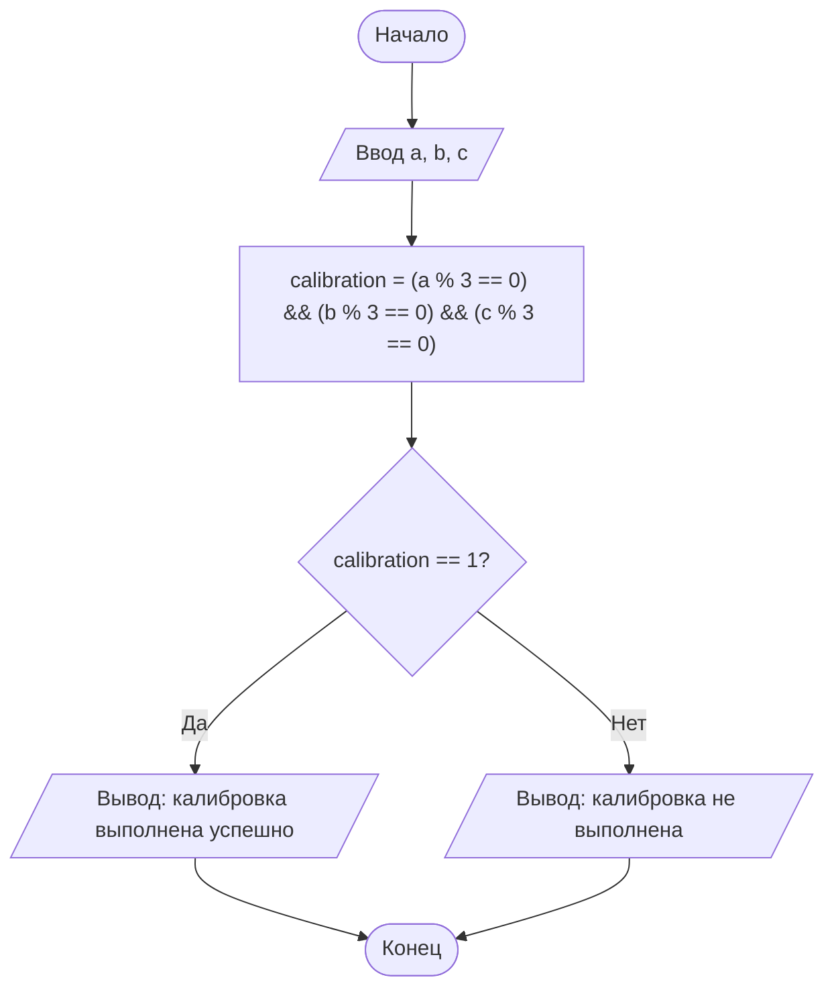

# Домашнее задание к работе 4

## Условие задачи

14. Калибровка станка

Три важнейших параметра станка (A, B, C) должны быть идеально отлажены. Система калибровки выдаёт сообщение об успехе, если каждое из значений параметра кратно трём. Запишите условие успешной калибровки.

**Вариант 14**

## 1. Алгоритм и блок-схема

### Алгоритм

1. **Начало**
2. **Ввести исходные данные:**

• `a` - значение параметра A;

• `b` - значение параметра B;

• `c` - значение параметра C.

3. **Составить условие успешной калибровки (каждое значение кратно трём):**

• `calibration = (a % 3 == 0) && (b % 3 == 0) && (c % 3 == 0)`

• значение `calibration` равно 1, если условие выполнено, и 0, если нет.

4. **Вывести значения параметров и значение `calibration`, а также сообщение об успехе или неудаче калибровки.**
5. **Конец**

### Блок-схема



## Реализация программы

```c
#include <stdio.h>
#include <locale.h>

int main()
{
    setlocale(LC_ALL, ".UTF-8");

    int a, b, c;
    int calibration;

    /* 1. Ввод значений параметров станка */
    puts("Введите значение параметра A");
    scanf("%d", &a);
    puts("Введите значение параметра B");
    scanf("%d", &b);
    puts("Введите значение параметра C");
    scanf("%d", &c);

    /* 2. Условие: каждое из значений кратно трём */
    calibration = (a % 3 == 0) && (b % 3 == 0) && (c % 3 == 0);

    /* 3. Вывод результата */
    printf("Параметры станка: A = %d, B = %d, C = %d\n", a, b, c);
    printf("Калибровка успешна (1 - да, 0 - нет): %d\n", calibration);

    if (calibration)
    {
        puts("Калибровка выполнена успешно: все параметры кратны трём.");
    }
    else
    {
        puts("Калибровка не выполнена: не все параметры кратны трём.");
    }

    getchar();  /* забирает Enter, оставшийся после ввода */
    getchar();  /* ждёт нажатия Enter, чтобы окно не закрылось */
    return 0;
}
```

## Результаты работы программы

## Успешная калибровка

```
Введите значение параметра A
9
Введите значение параметра B
12
Введите значение параметра C
30
Параметры станка: A = 9, B = 12, C = 30
Калибровка успешна (1 - да, 0 - нет): 1
Калибровка выполнена успешно: все параметры кратны трём.
```

## Неуспешная калибровка

```
Введите значение параметра A
10
Введите значение параметра B
12
Введите значение параметра C
30
Параметры станка: A = 10, B = 12, C = 30
Калибровка успешна (1 - да, 0 - нет): 0
Калибровка не выполнена: не все параметры кратны трём.
```

## Информация о разработчике

Кочергин Савелий, группа бИД-261 пдг2
